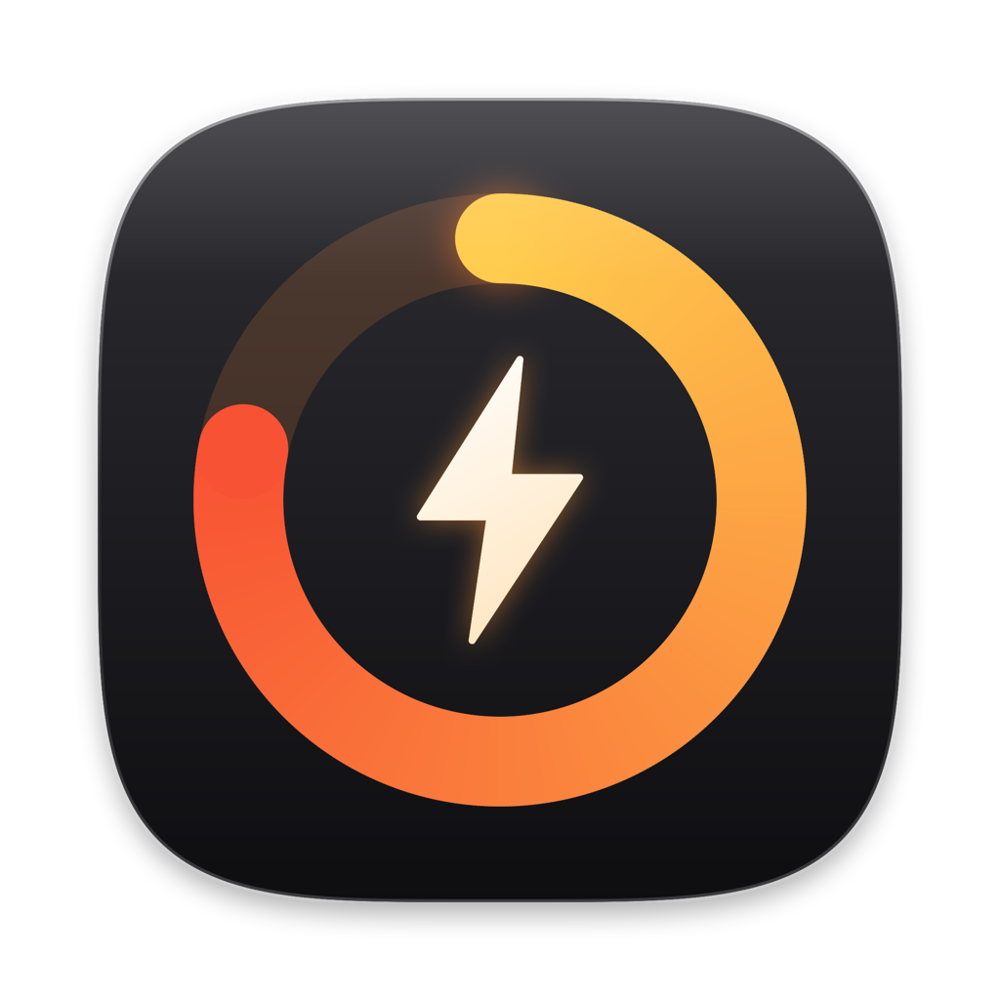
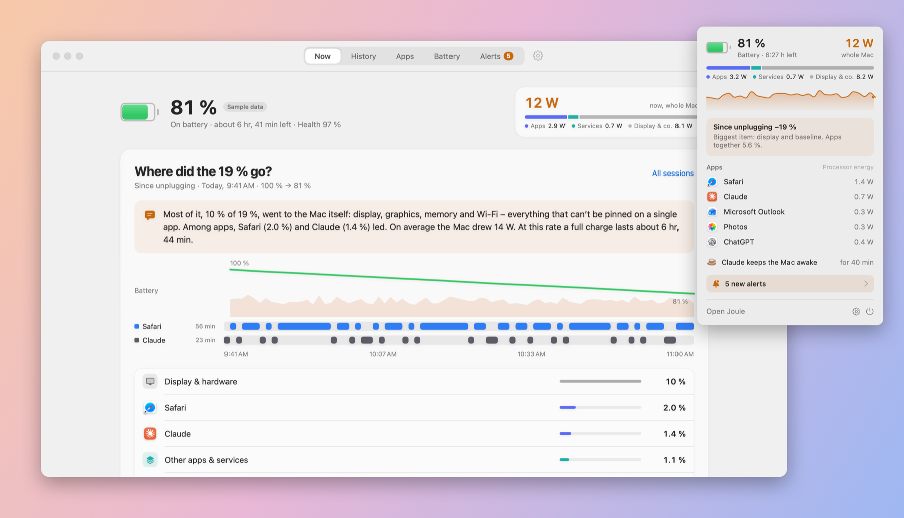
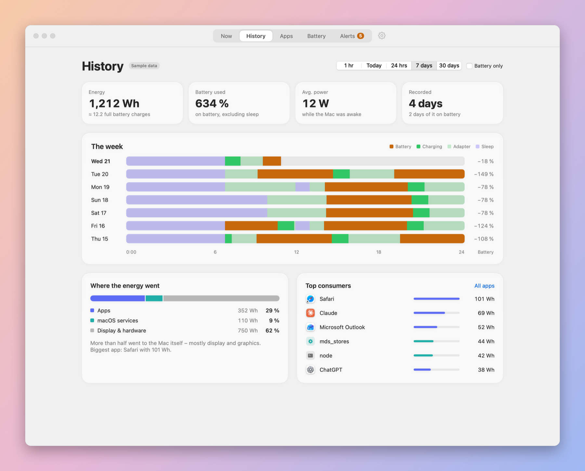
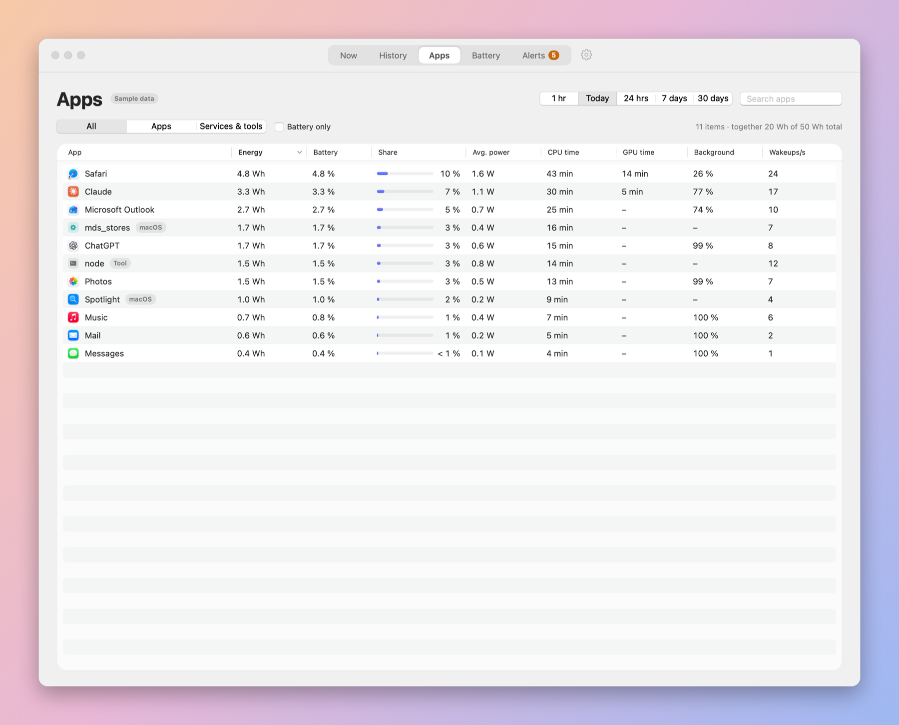
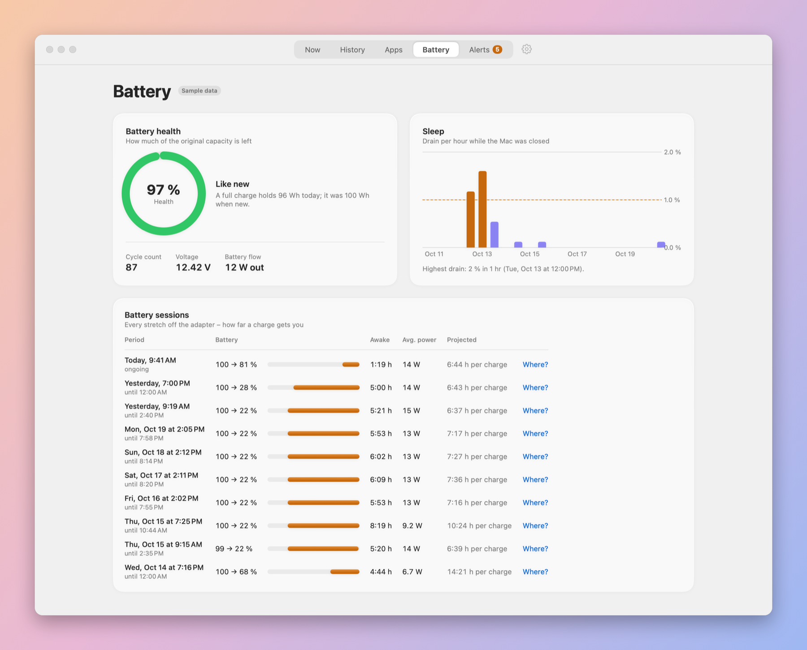
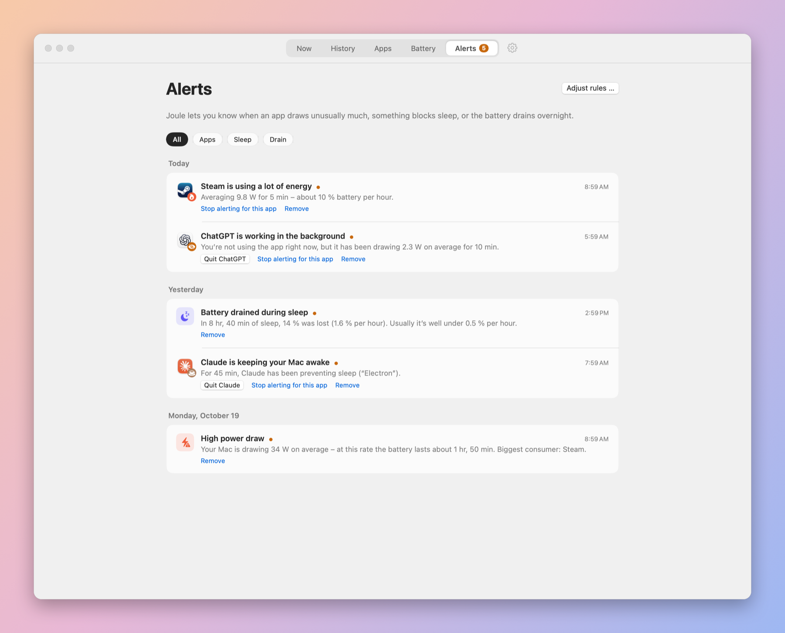
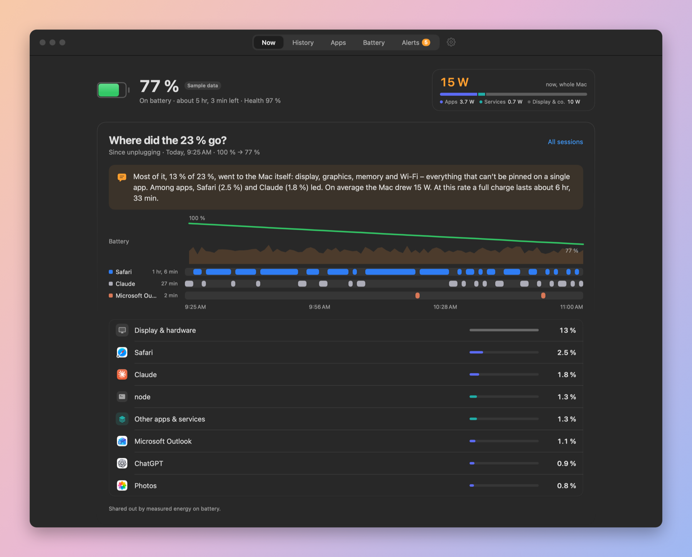

<p align="center">
  
</p>

<h1 align="center">Joule</h1>

<p align="center">
  <b>See where your MacBook’s battery actually goes.</b><br>
  Live power, per-app energy, a plain-language explanation of every lost percent – and alerts when something drains it.
</p>

<p align="center">
  <a href="../../releases/latest">Download</a> ·
  <a href="#how-joule-measures">How it measures</a> ·
  <a href="#build-from-source">Build from source</a>
</p>



<sub>All screenshots use Joule’s built-in sample data.</sub>

## What it does

- **Where did the battery go?** Since you unplugged, Joule splits every lost percent between your apps, macOS services, the display & hardware and sleep – and the parts add up to exactly what you lost. A short paragraph explains it in plain words: *“Most of it went to the display. Among apps, Safari led. At this rate a full charge lasts about 6 h 44 min.”*
- **Session timeline.** Battery level, power draw, which app was in front, when the screen was locked and when the Mac slept – in one view.
- **Live in the menu bar.** Whole-Mac watts, the split into apps / services / display, a live power curve and the apps drawing right now.
- **Alerts that matter.** An app pulling a lot of power (in the foreground or quietly in the background), high total drain, something keeping your Mac from sleeping, or battery lost overnight. Thresholds are adjustable, apps can be muted.
- **History.** Days as timelines (battery, charging, adapter, sleep), energy by source, top consumers, battery sessions with projected runtime, sleep drain per night and battery health.
- **Light on the battery itself.** Around 1–3 mW in the background. Nothing is sent anywhere.
- **Languages:** English, Deutsch, Français, Español.

| History | Apps |
|---|---|
|  |  |
| **Battery** | **Alerts** |
|  |  |

<details>
<summary>Dark mode</summary>


</details>

## Install

1. Download `Joule-x.y.z.dmg` from the [latest release](../../releases/latest) and drag **Joule** into **Applications**.
2. Joule is open source and not notarized by Apple, so macOS blocks the first launch. Open it once anyway:
   - **macOS 15 and later:** try to open Joule, then go to **System Settings › Privacy & Security** and click **Open Anyway**.
   - **macOS 14:** right-click Joule in Applications and choose **Open**.
   - Or in Terminal: `xattr -dr com.apple.quarantine /Applications/Joule.app`
3. Joule lives in the menu bar. Turn on **Open at login** in its settings (⌘,) so it never misses a minute.

**Requirements:** a MacBook with Apple silicon, macOS 14 Sonoma or later. No administrator rights needed.

## How Joule measures

Joule needs no root privileges and no helper daemon. It reads what macOS already exposes to a normal app:

| What | Source | Accuracy |
|---|---|---|
| Whole-Mac power | Battery gauge, `AppleSmartBattery › PowerTelemetryData.SystemLoad`, every 10 s | Measured, includes the display |
| Energy per process | `proc_pid_rusage(RUSAGE_INFO_V6).ri_energy_nj`, every minute (every 3 s while you look) | Measured, processor only |
| GPU time per app | `IOAccelerator` user clients, `accumulatedGPUTime` | Measured (time, not energy) |
| Processes of other users (WindowServer, …) | CPU time from `/bin/ps`; energy = CPU time × energy per CPU second of the measurable processes | **Estimated**, marked “≈” |
| Helpers → app | Outermost `.app` bundle, otherwise the “responsible process” (like Activity Monitor) | e.g. WebKit processes count for Safari |
| What keeps the Mac awake | `IOPMCopyAssertionsByProcess` | Exact |
| Display & hardware | Whole-Mac power minus all processes | Computed remainder |

A few honest limits:

- The battery gauge only updates its power reading every 20–60 seconds, so very short spikes are smoothed out.
- Per-app numbers are processor energy. Graphics work and the display end up in “Display & hardware”.
- `kernel_task` is invisible without root and is part of the remainder as well.
- Intervals that span sleep (including Power Nap dark wakes) are discarded, so sleep is never counted as awake time.

## Privacy

Everything stays on your Mac in `~/Library/Application Support/Joule/history.sqlite` – per-minute data for 7 days, hourly data for 90 days. Joule makes no network connections.

## Build from source

Only the Command Line Tools are needed (`xcode-select --install`), no Xcode.

```bash
./scripts/install.sh            # check, build and install to /Applications (or update it)
./scripts/install.sh --login    # same, and turn on open at login
./scripts/check.sh              # run the checks for the measuring core
./scripts/release.sh            # build dist/Joule-x.y.z.dmg and .zip
python3 scripts/l10n.py         # extract strings, verify translations, write *.lproj
```

Useful flags:

```bash
open -n .build/Joule.app --args --demo                  # two weeks of sample data, records nothing
.build/Joule.app/Contents/MacOS/Joule --probe           # one measurement printed to the terminal
.build/Joule.app/Contents/MacOS/Joule --demo --snapshot shots -AppleLanguages "(en)"   # screenshots of every page
```

### Translations

The source strings are German. `scripts/l10n.py` uses the Swift compiler to extract every localizable string, checks it against [`Localization/translations.json`](Localization/translations.json) (including placeholders) and writes `Resources/*.lproj`. Adding a language means adding one column there.

### Project layout

```
Sources/JouleCore   measuring, storage, reports, alerts, explanations (no UI)
Sources/Joule       SwiftUI app: window, menu bar panel, settings
Sources/JouleChecks the checks (the Command Line Tools ship no XCTest)
scripts/            build, install, release, localization, icon and screenshot helpers
```

## License

[MIT](LICENSE)
